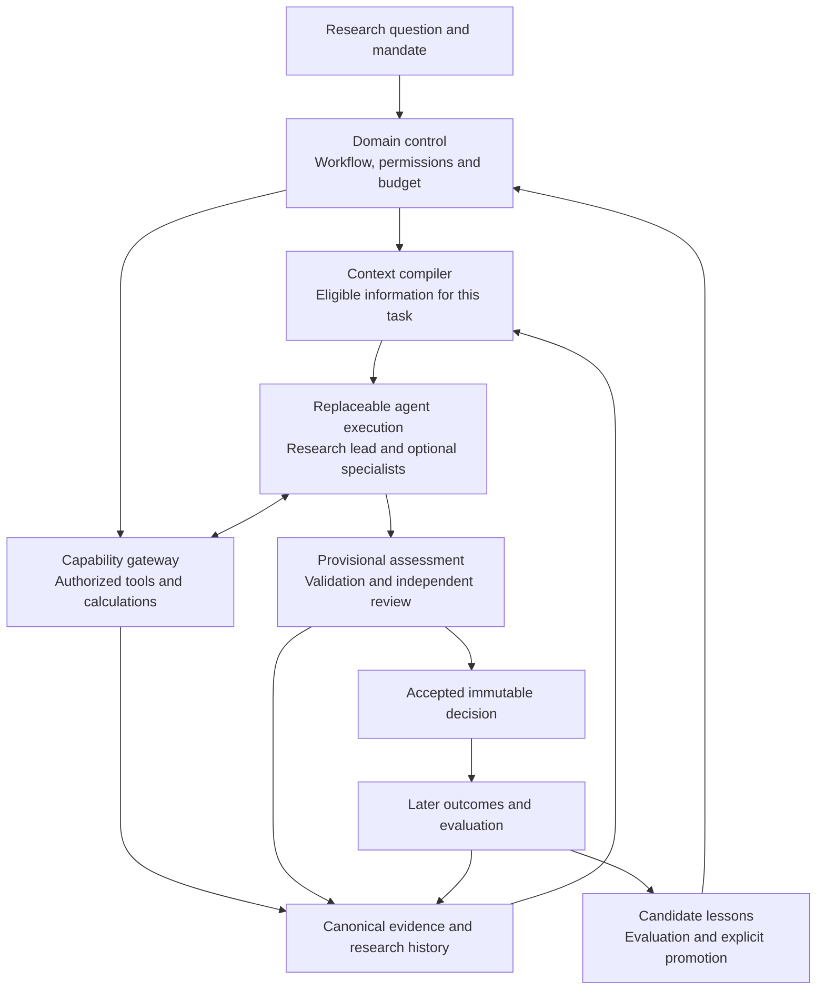
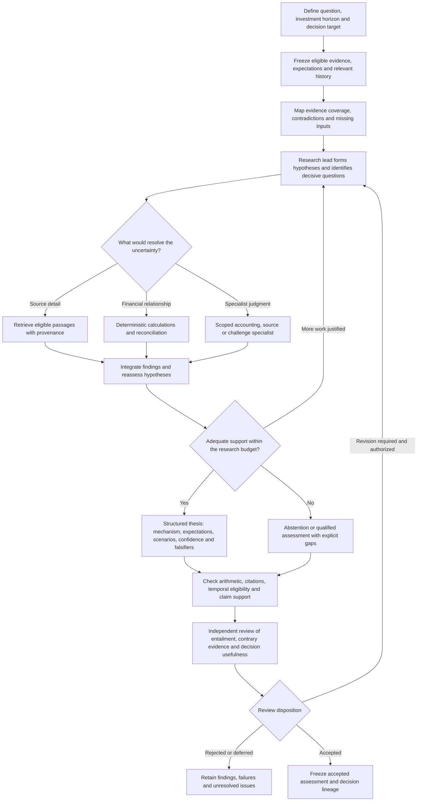
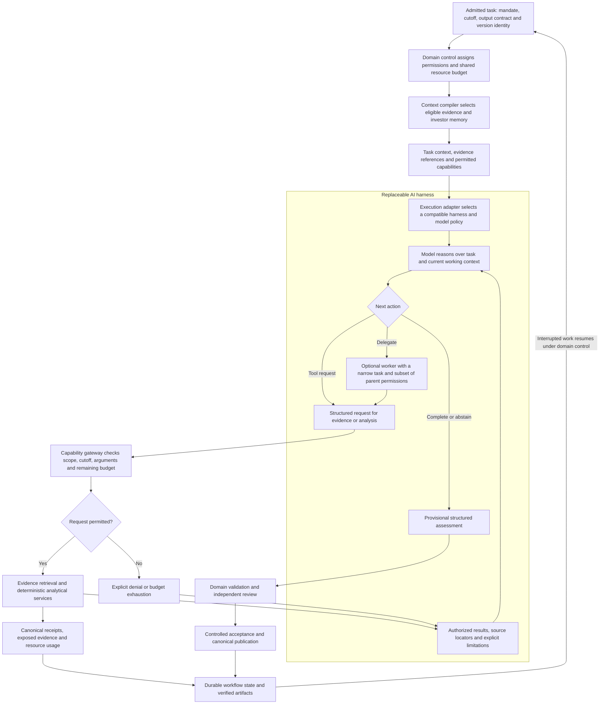
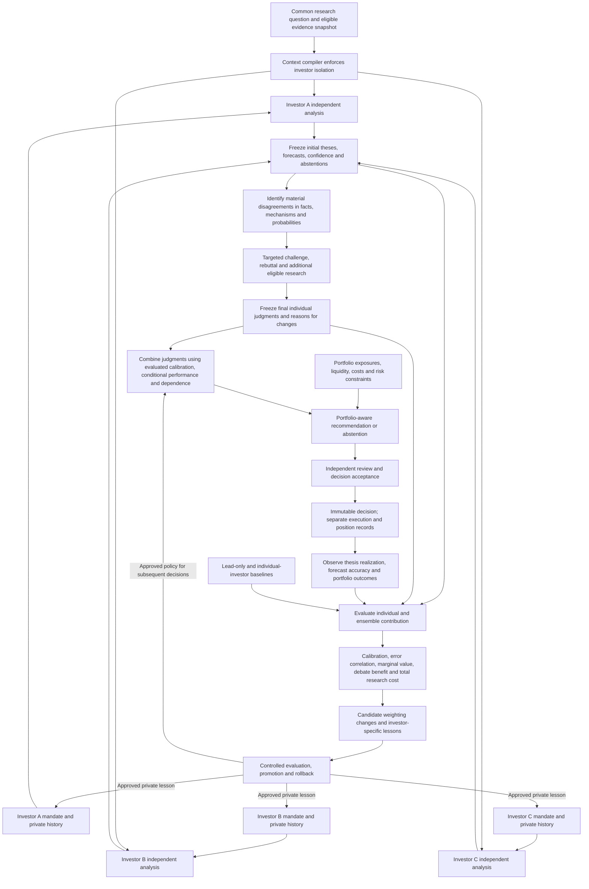

# Investment Research Agent System

An investment research platform designed to turn evidence, analytical judgment and subsequent outcomes into a durable, inspectable research history. AI agents investigate questions and propose conclusions; the surrounding system preserves what they knew, how they reasoned, what was accepted and what happened afterward.

The central architectural choice is to keep investment knowledge and decision authority independent of the model or agent harness used to perform the work. A harness manages the model-and-tool execution loop. The platform owns evidence, research workflows, permissions, evaluation and attributable investor history. This allows execution technology to evolve while accumulated research remains usable and comparable.

## Project reports

The public reports in `docs/public/` provide complementary introductions:

- [Investment Research Agent System Business Report](docs/public/Investment_Research_Agent_System_Business_Report.docx) explains the research problem, intended users, durable value, complete research lifecycle and success criteria.
- [Agent Harness and Investor Architecture Report](docs/public/Agent_Harness_Investor_Architecture_report.docx) explains ownership boundaries, AI research and harness flows, persistent investor memory, ensemble analysis, outcome attribution and controlled learning.

The README provides the conceptual overview. The reports give a fuller account of the business and architectural thinking. Public companion documents reside in `docs/public/`; internal working documents remain private.

## The research problem

Investment research combines factual reconstruction with uncertain judgment. An analyst must establish what changed, compare it with expectations, understand the economic mechanism, examine contrary evidence and specify what would invalidate the thesis. A persuasive answer is useful only if those steps can be inspected.

The project therefore treats a research case as a connected record: original sources, observations, calculations, claims, assumptions, thesis revisions, review decisions and eventual outcomes. Its value accumulates across investigations. A later analyst should be able to recover the original information set, understand a disagreement and evaluate a decision without silently importing hindsight.

## Architecture

The design has three logical planes. They describe responsibilities and trust boundaries and can coexist within one application.

| Plane | Responsibility | Why the separation matters |
| --- | --- | --- |
| Domain control | Research questions, targets, workflow stages, permissions, budgets and acceptance | Decision authority remains explicit and enforceable outside the model |
| Canonical knowledge and state | Versioned evidence, calculations, research artifacts, decisions, reviews and outcomes | Research survives runtime changes and supports attributable evaluation |
| Agent execution | Model interactions, tool use, temporary working context and optional delegation | The execution engine can be replaced without migrating the investment record |

Two boundaries connect the planes. The **context compiler** assembles the information a task is allowed to see, with exact source versions, a time cutoff, relevant history and explicit omissions. It combines a compact initial context with references to further evidence. Retrieval remains subject to the same eligibility rules.

The **capability gateway** exposes bounded services for reading evidence and obtaining deterministic calculations. It enforces permissions and budgets independently of agent instructions. A research agent can request work and propose findings; acceptance and consequential publication belong to the controlled workflow.

The system resumes from durable workflow stages and verified artifacts after an interruption. Native conversations and scratch memory support execution, while the canonical research record provides continuity across sessions and harnesses.

## Design principles that distinguish the system

### Evidence and time are part of the reasoning contract

Every investigation fixes its question, target, information cutoff and source versions. Event time, public availability and system capture are distinct: a document about an earlier event may still have arrived too late for a historical decision. Corrections retain their lineage rather than replacing the evidence used by an earlier run.

Claims distinguish observations, calculations, assumptions and inference. Financial arithmetic comes from source-linked deterministic services. Contrary evidence, missing inputs and falsification conditions remain visible. Citation checks establish traceability; semantic review must still assess whether the evidence supports the conclusion.

### Agent topology follows the research need

The default design uses one research lead. Deterministic services perform repeatable acquisition, reconciliation and arithmetic; bounded model tasks handle suitable transformations. Specialists receive narrow questions when their expected contribution justifies the additional work.

This makes delegation an empirical choice. A larger committee must demonstrate better coverage, fewer material errors or useful independent information against a lead-only baseline, including its cost and review burden.

### Persistent investors have attributable identities

The investor layer separates an **archetype**, which defines philosophy, horizon and constraints, from an **instance**, which binds that mandate to particular model, runtime and context-policy versions and a private history. Several instances can follow the same investment philosophy while differing in model, reasoning process and accumulated experience.

Memory separates mandate, source-linked episodes, computed statistics and approved lessons. Shared factual corrections can benefit all investors; private behavioral lessons remain attributable to the investor that generated them. This preserves the ability to study distinct approaches over time.

### Learning must survive evaluation

Contemporaneous decisions remain immutable. Later outcomes and post-mortems append to the record. The design keeps a recommendation, its execution and its realized outcome separate so that thesis quality, timing, sizing and execution effects can be assessed independently.

A proposed lesson becomes a versioned candidate with supporting evidence, a comparison plan and a rollback path. Deterministic statistics supply empirical memory; model reflection proposes interpretations. Promotion requires evaluation, with attention to sample size, overlapping events and changing regimes.

For ensembles, investors commit independent opinions before seeing peer conclusions. Debate can then be evaluated by comparing initial and final judgments. Diversity is measured through error correlation and marginal contribution; distinct personas alone do not establish independent information.

## AI research workflow

The research lead develops a causal investment thesis from a defined information set. Its work moves between evidence gathering, financial analysis and hypothesis testing. The workflow distinguishes an unresolved question from an unsupported assertion and allows abstention when the evidence cannot support a decision.

A specialist contributes evidence or analysis to a specific question. The lead remains responsible for synthesis, while independent review examines the resulting argument. Every revision preserves the preceding record, so a polished final assessment does not erase the failures that produced it.

## AI harness and execution boundary

The harness supplies the iterative machinery for model calls, tool requests, working context and delegation. The domain control plane supplies the mandate and determines the permissible actions. This boundary keeps model reasoning flexible while preserving explicit authority over information access and research decisions.

The lead and its workers share one resource budget. Workers cannot enlarge their permissions, and retrieved content cannot confer authority. Model completion produces a candidate result; the workflow determines whether it is acceptable.

The platform records consequential inputs, tool results, versions and outputs alongside diagnostic trace references. Recovery reconciles uncertain operations and reuses verified artifacts before further work begins. A new harness session can continue a research case from these durable records without inheriting the previous runtime's internal session format.

## Ensemble analysis

An ensemble tests whether independent investor judgments add useful information. Investors can differ in philosophy, model, context policy or private experience. They receive the same eligible shared evidence snapshot, supplemented only by their own permitted history. Peer opinions remain unavailable until each initial decision is committed.

Aggregation accounts for dependence between investors: several highly correlated opinions may contain little additional information. Conditional performance estimates carry uncertainty and sample-size context, and recent returns alone cannot determine ensemble weights. Comparisons include abstentions, research cost and reviewer effort.

Retaining both pre-debate and post-debate judgments makes persuasion measurable. Outcome analysis separates a correct thesis from a favorable return, and a useful forecast from a well-sized portfolio action. Approved lessons enter only subsequent decisions; original information sets and judgments remain intact.

## Evaluation and scope

The system evaluates operational reliability, research quality, forecast calibration and portfolio contribution separately. Source-linked claims and reproducible calculations support review; contemporaneous forecasts and later outcomes support empirical assessment. Predictive advantage is a hypothesis to test through controlled comparisons and prospective evidence.

The project covers research, attributable investor learning, ensemble analysis and paper-portfolio evaluation. Portfolio recommendations incorporate holdings, exposure, liquidity, opportunity cost and transaction costs. Decision records remain separate from execution records and outcomes. Live brokerage execution sits outside the research system's scope.
